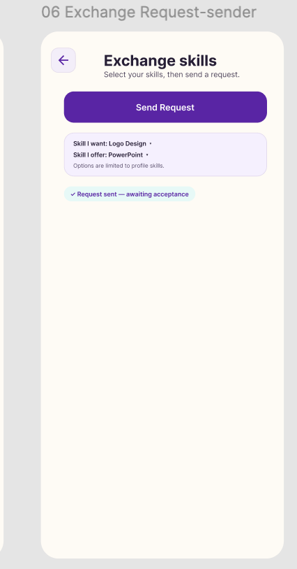
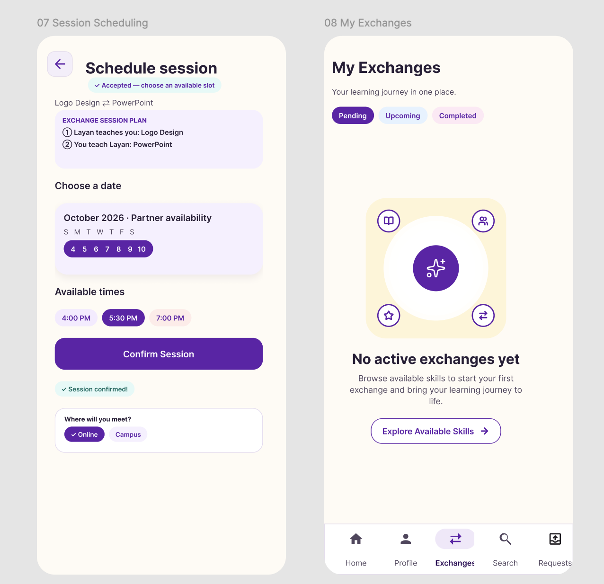

# Haya Alamri — M2B Screen Explanations

Prototype: https://www.figma.com/design/C7kJyspozVnCzA4Zkg1uwp

## 06 — Exchange Request (sender)

**Purpose:** Let a student propose a two-way skill exchange. The screen shows the skill wanted (Logo Design), the skill offered (PowerPoint), and a Send Request action. Choices are limited to profile skills. After submission, a visible message says “Request sent — awaiting acceptance.”

**User flow:** Select the wanted and offered skills → send the request → see the pending confirmation → wait for the partner to accept → proceed to scheduling after acceptance. The screenshot shows the sender’s pending state; the partner’s acceptance interaction is not shown.

**Stage 1 response:** Supports the requested request → pending → accept → schedule flow by making the selected skill pair and pending status explicit. The back control supports navigation cleanup. Acceptance and the transition to scheduling still require prototype verification.

## 07 — Session Scheduling

**Purpose:** Arrange a session after an exchange is accepted. The accepted status and session plan identify both teaching roles. Students choose an available date, a time, and a meeting location (Online or Campus), then confirm the session. A “Session confirmed!” message provides feedback.

**User flow:** Accepted exchange → check the two-way session plan → choose an available date and time → select Online or Campus → confirm the session → see confirmation. The screenshot displays the location choices below the confirmation area; their interaction order needs to be checked in the prototype.

**Stage 1 response:** Addresses scheduling location through explicit Online/Campus choices and continues the accepted-request-to-scheduling flow. Availability choices and confirmation make the scheduling state clearer. The static image does not verify disabled unavailable slots, validation, or actual booking behavior.

## 08 — My Exchanges (empty state)

**Purpose:** Help students track exchanges with Pending, Upcoming, and Completed tabs. When there are no active exchanges, the page explains the empty state and offers “Explore Available Skills.” The bottom navigation includes Home, Profile, Exchanges, Search, and Requests, with Exchanges selected.

**User flow:** Open Exchanges from the bottom navigation → choose a status tab → inspect exchanges when available; in the shown empty state, use Explore Available Skills to return to skill discovery.

**Stage 1 response:** Addresses the empty-state requirement with an explanation and next action, and shows labeled bottom navigation with an active destination. Material 3 implementation, tap targets, contrast compliance, and all destination links need prototype or implementation verification. Loading and error states are not evidenced by this image.

## Evidence limits

These two supplied screenshots cover three screens. The scheduling and exchanges screens remain together in the original image. They do not show the completed-exchange Rate Your Exchange button or Review Exchange screen, sign-up validation, recommendation explanations, loading/error states, or measured accessibility results. Those items are not marked as verified here.
